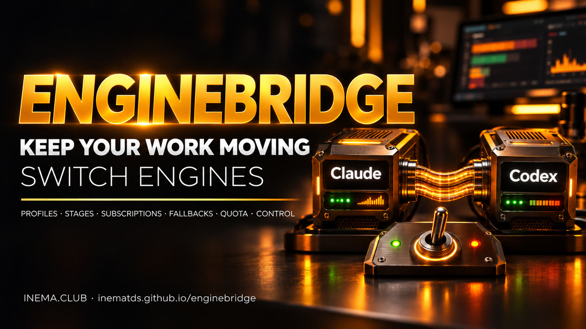

# EngineBridge

[](https://inematds.github.io/enginebridge/guia/en/)

**[Português](README.md) · [English](README.en.md) · [Español](README.es.md)**

## What it is

Your automation can stop when a subscription reaches its quota, even if another one is available. EngineBridge is a local tool for choosing which AI engine handles each stage and using a declared alternative when allowed. It is for people who maintain bots, scripts, and routines with Claude Code and Codex. You define profiles, models, and effort; the program resolves the choice without consulting an AI. Running text requires Python and subscription-authenticated programs.

**Version 1.0.0 — functional local core; integration with real systems is still pending.**

[Complete guide](https://inematds.github.io/enginebridge/guia/en/) · [Architecture](docs/ARQUITETURA.md) (Portuguese) · [Adoption plan](docs/ADOCAO.md) (Portuguese) · [References and Astra review](docs/REFERENCIAS.md) (Portuguese)

## Install and verify

```bash
git clone https://github.com/inematds/enginebridge.git
cd enginebridge
python3 -m venv .venv
source .venv/bin/activate
python3 -m pip install -e .
python3 -m unittest discover -s tests -v
python3 -m enginebridge resolve --project demonstracao --stage roteiro
```

Requires Python 3.11+ and PyYAML 6. The demonstration profiles use explicit models and can be resolved without signing in. Inherited levels use `~/.config/inema/modelos.env`; on another machine, configure `modelos_env` and the executable paths in the YAML. Resolution does not check whether the model is available in the subscription.

## Simulate a switch without consuming models

```bash
printf 'Create a short script.' | python3 -m enginebridge --state .state/demo.sqlite run --project demonstracao --stage roteiro --simulate --fail-first
python3 -m enginebridge --state .state/demo.sqlite status
```

The simulation produces a quota rejection in Codex, records a temporary suspension in SQLite, and delivers the same request to the mock Claude executor. The `simulado` field distinguishes this output from a real run. It does not modify services, check balances, or call models.

## Prepare accounts on a new machine

Install Claude Code and Codex, authenticate through your subscriptions in the terminal, and set `binario` in the YAML. Never use an API key. The optional `conta_env` field points to a data file with `CODEX_HOME=/path/to/account`; without that file, the default Codex account is used.

```bash
codex login
claude auth login
mkdir -p ~/.config/inema
test -f ~/.config/inema/modelos.env || cp config/modelos.example.env ~/.config/inema/modelos.env
```

The example models file is copied only if no central configuration exists. The `demonstracao/padrao` stage inherits the global engine and lets you observe the switch with `prefer`; roteiro and crítica remain tied to fixed profiles.

## Global preference and exceptions

```bash
python3 -m enginebridge prefer claude
python3 -m enginebridge resolve --project demonstracao --stage padrao
python3 -m enginebridge prefer codex
python3 -m enginebridge resolve --project demonstracao --stage padrao
```

`prefer` modifies only this YAML and preserves comments. Stages with an explicit `perfil` or `motor` remain fixed; the global switch affects stages without that choice. Inherited model and effort settings continue to come from the existing central source. Effort does not measure quality equivalence between model families.

```bash
python3 -m enginebridge --state .state/demo.sqlite block --pool codex-principal
python3 -m enginebridge --state .state/demo.sqlite unblock --pool codex-principal
```

Suspending an account prevents new admissions in EngineBridge, including for jobs that have already been resolved. Manually removing the block preserves any temporary quota suspension. By default, state is stored in `~/.local/state/enginebridge/state.sqlite`; all consumers on the same machine must share this path and configuration. Do not put this SQLite database on a network drive.

## Run text through your subscription

```bash
printf 'Reply with one sentence about profiles by stage.' | python3 -m enginebridge run --project demonstracao --stage roteiro
```

This command uses the selected subscription. It runs Claude Code or Codex in a temporary directory, without personal MCP, an enabled shell, or a shared native session. API credentials are removed from the environment. It does not run agent workflows, publishing, image generation, or translation. The binaries must accept the arguments documented by the adapter; local tests use mock executables and do not verify sign-in or the real operation of either CLI.

## Continuity contract

- Selection by call, stage, project, and global preference, always subject to permissions and fixed stages.
- An explicit alternative for fixed stages; for open stages, project-level or global alternatives.
- Quota shared by account (`quota_pool`), regardless of model name; one simultaneous run per pool in this core.
- A structured quota rejection, with no partial response or tools, allows trying the alternative and persisting the temporary suspension.
- A local error, timeout, prose-only error message, or result rejected by the validator stops the work without an automatic retry.
- Each job stores a resolved copy of the models; urgent blocks and account changes are checked before each attempt.

Examples of Python and CLI usage are in `examples/`. There is no active integration with OpenPCBotV3, Refazvideo, or cron jobs. OpenRouter is listed as a disabled future extension; this version has no API adapter, even if someone changes `habilitado` in the YAML.

## Development

```bash
python3 -m compileall -q enginebridge examples tests
python3 -m unittest discover -s tests -v
python3 -m enginebridge --version
```

[MIT License](LICENSE). The design reuses references to independent providers from WiFi and the Astra review, preserved in `docs/`.
